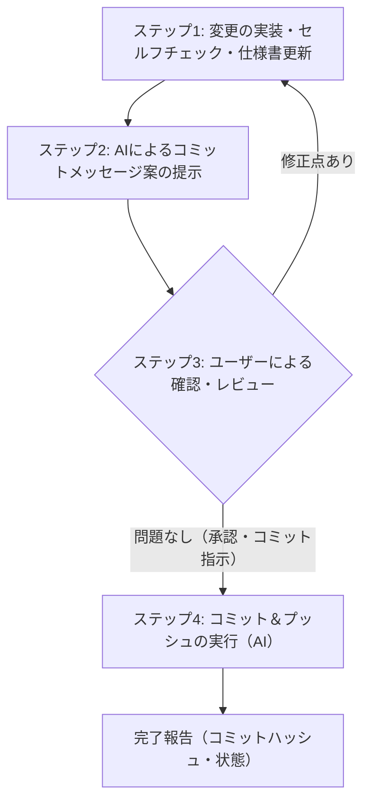

# Git運用ルール (Time Alert)

本ドキュメントは、「Time Alert」プロジェクトにおけるGitのコミット、プッシュ、ブランチ運用、およびコミットメッセージの作成規則を定義します。  
AIアシスタントと開発者（ユーザー）の安全かつスムーズな共同開発を実現し、変更履歴の可読性とトレーサビリティを維持することを目的とします。

---

## 1. コミット・プッシュの基本運用フロー（必須手順）

コードの変更および仕様書の更新を行う際は、**必ず以下の4ステップを遵守**してください。  
AIアシスタントがユーザーの明示的な承認なしにコミットやプッシュを勝手に行うことは禁止します。



### ステップ1: 変更の実装・セルフチェック・仕様書更新
1. 要求されたコードの変更を実装し、エラーチェックおよび動作検証を行う。
2. `@gemini.md` のルール8「仕様書の動的更新」に従い、コードの変更内容に合わせて `仕様書/` フォルダ内の関連ドキュメント（要件定義書、UI・UX設計書、システム設計書など）を更新する。
3. 一時的なデバッグログや不要な変更が含まれていないかセルフチェックする。

### ステップ2: コミットメッセージ案の出力（AI側）
- 実装と仕様書更新が完了したら、作業内容のサマリー（変更ファイル・主な修正点）とともに、後述の規則に沿った**コミットメッセージ案を出力**する。
- **※この段階ではコミット（`git commit`）やプッシュ（`git push`）を実行せず、ユーザーの確認を待つ。**

### ステップ3: ユーザーによるチェックと承認指示
- ユーザーが変更内容（`git status` や `git diff` 等）およびコミットメッセージ案を確認する。
- 問題がないことを確認したら、ユーザーからAIに対してコミット・プッシュの指示（例:「コミットしてください」「問題ないのでプッシュまでお願いします」等）を出す。
- 修正やメッセージの変更要望がある場合は指示を受け、AIが対応して再度メッセージ案を提示する。

### ステップ4: コミット＆プッシュの実行
- ユーザーの承認・指示を受けてから、AIが実際に以下のコマンドを実行する。
  ```bash
  git add <変更ファイル...>
  git commit -m "<承認されたコミットメッセージ>"
  git push origin <ブランチ名>
  ```
- コミットのハッシュ値とプッシュの成功を確認し、結果をユーザーに報告する。

---

## 2. コミットメッセージの作成規則

これまでのコミット履歴（日本語、動詞述語型、具体的内容の明記）を踏襲し、プロジェクトの一貫性を保ちます。

### 2.1. 基本原則
1. **言語:** 日本語で記述する。
2. **文末表現:** 動詞の終止形（「〜を追加」「〜を実装」「〜を修正」「〜を変更」「〜を更新」など）を用いる。
3. **仕様書更新の明記:** コード変更に伴い仕様書を更新した場合は、必ず末尾に「`し、仕様書の更新を実施`」を付与する。
4. **対象と目的の明示:** どの画面・機能・ファイルに対するどのような変更かが一目で分かるように記述する。

### 2.2. 動詞の使い分けガイドライン

| 目的 | 主な文末表現 | 過去のコミット例 |
| :--- | :--- | :--- |
| **新規機能追加** | `〜を追加`<br>`〜を実装` | `タイマー機能を実装`<br>`インポート、エクスポート機能を追加`<br>`アラーム機能に「今日をスキップ」機能を追加` |
| **不具合修正** | `〜を修正` | `アラーム機能の自動有効化条件を修正` |
| **仕様変更・調整** | `〜を変更`<br>`〜を改善` | `設定画面を専用の独立したページで表示するように変更`<br>`アイコンを正しいものに変更。 少しデザインも変更。` |
| **リファクタリング** | `〜を分割`<br>`〜をリファクタリング` | `sidepanel.jsを複数のファイルに分割し視認性とメンテナンス性を向上` |
| **ドキュメント・設定** | `〜を更新` | `i18n対応を追加し、詳細設定ボタンとメモ入力のプレースホルダーを更新` |

### 2.3. 書式フォーマット

#### パターンA: 1行要約形式（標準）
簡潔に要点が伝わる場合、または小〜中規模な変更に適用します。

```text
<対象・機能>に<変更内容>を<動詞>し、仕様書の更新を実施
```

**具体例:**
- `タイマー・アラーム鳴動時にサイドパネルから停止できる機能を追加し、仕様書の更新を実施`
- `設定画面に音声プレビュー機能と閉じるボタンを追加`
- `アクティブアイテムヘッダーを追加し、タイマーとアラームの状態を表示する機能を実装`

#### パターンB: 複数行形式（複合・大規模な変更時）
複数のファイルにまたがる修正や、背景・詳細を明記したい場合に適用します。1行目を要約行（50〜72文字程度）とし、空行を挟んで3行目以降に箇条書きで詳細を記述します。

```text
<1行要約: 対象・変更内容の全体像>

- <詳細な変更点1>
- <詳細な変更点2>
- <仕様書の更新内容>
```

**具体例:**
```text
タイマー時間変更時の自動有効化オプションを追加し、仕様書の更新を実施

- 設定画面に「タイマー時間変更時の自動有効化」トグル項目を追加
- タイマー数値変更時に自動でカウントダウンを開始する判定ロジックを実装
- 未翻訳部分のi18n対応を追加
- 仕様書/要件定義書.mdおよびUI・UX設計書.mdに最新仕様を反映
```

---

## 3. Git運用のベストプラクティス・注意事項

安全な共同開発とリポジトリの整合性を保つため、以下の項目を遵守してください。

### 3.1. 作業前の最新化 (`git pull`)
- 新しい作業に着手する前、またはブランチで作業を再開する前は、必ずリモートの最新状態を取り込んでから作業を開始する。
  ```bash
  git pull origin main
  ```
- これにより、他の環境や作業とのコンフリクトを未然に防ぐ。

### 3.2. コミットの粒度（単一責務の原則）
- 1つのコミットには1つの論理的な変更単位（1機能の追加、1箇所のバグ修正など）のみを含める。
- 無関係な複数の変更を1つのコミットに混同させない。
- **コード変更と仕様書更新は不可分**であるため、必ずセットで1コミットにまとめる。

### 3.3. コミット前の差分検証
- ステージング前・コミット前に必ず差分を確認する。
  ```bash
  git status
  git diff
  ```
- 意図しない修正、不要な改行差分、テスト用コード（`console.log` 等）、個人情報が含まれていないかを確認する。

### 3.4. ブランチ運用方針
- **基本運用:** 現在のプロジェクト規模では `main` ブランチでの運用を中心とする。
- **ブランチ作成の推奨:**
  - 影響範囲の広い大規模なリファクタリング
  - 実験的な機能の実装やアーキテクチャの変更
  - このような作業を行う場合は `feature/機能名` や `fix/不具合名` などの作業ブランチを作成し、検証後に `main` にマージする。

### 3.5. 危険な操作の禁止
- **`git push --force` (`-f`) の禁止:**  
  リモートのコミット履歴を上書き・破壊する可能性があるため、共有リポジトリへの強制プッシュは原則禁止とする。
- **破壊的コマンドの慎重な扱い:**  
  `git reset --hard` や `git clean -fd` など、未コミットの作業内容を完全に消去するコマンドは、ユーザーの明示的な合意なしに実行しない。

### 3.6. 機密情報・不要ファイルの除外
- APIキー、認証トークン、プライベート情報、OS生成の一時ファイル（`.DS_Store` や `Thumbs.db` 等）をコミットしない。
- 必要に応じて `.gitignore` を適切に設定・管理する。

### 3.7. コンフリクト発生時の対応フロー
- プルやマージでコンフリクトが発生した場合、AIが独断でファイルを強制上書きして解消してはならない。
- 衝突した箇所と原因を整理し、どちらの変更を採用すべきか（またはどのように統合すべきか）をユーザーに報告・相談した上で解決する。
